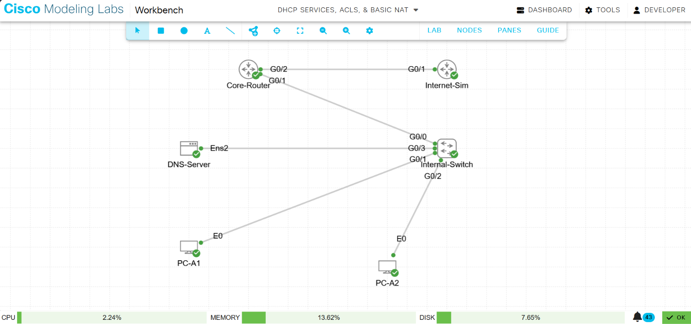
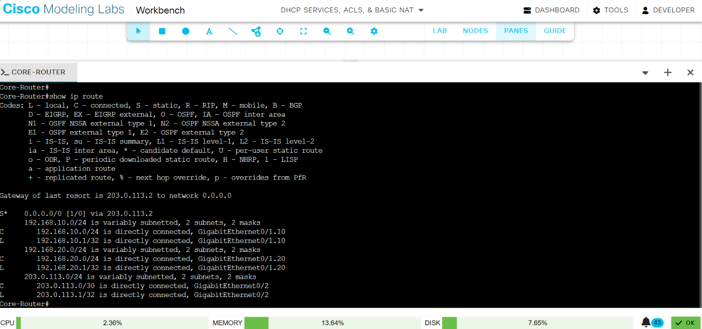
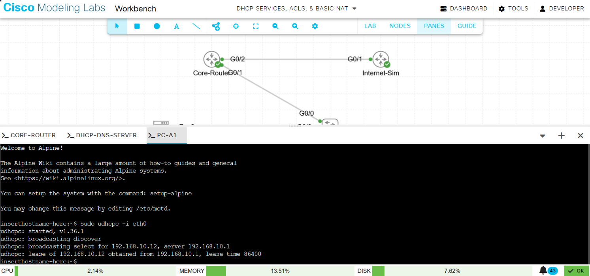
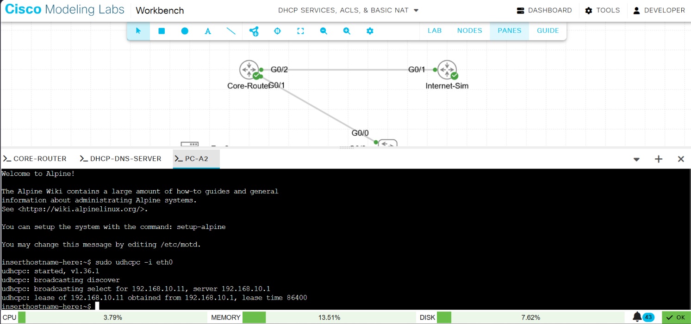
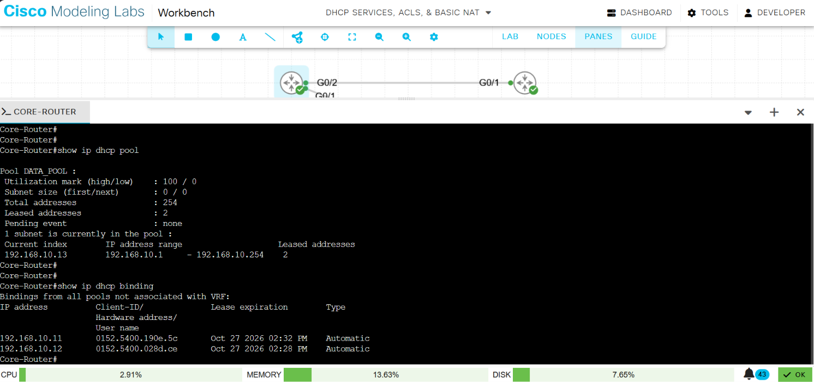
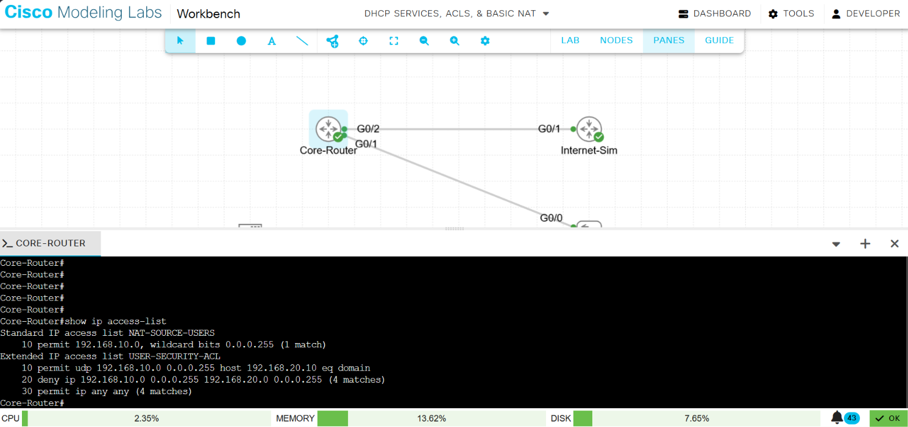
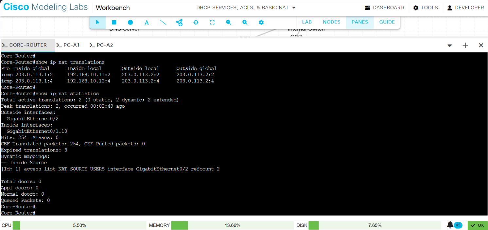

# Automated Edge Infrastructure: DHCP Services, Inbound Extended ACLs & NAT Overload

## Production Architecture & Framework

This repository contains the verified deployment artifacts and real-time operational state metrics for a secure, multi-segmented branch office network. Implemented inside Cisco Modeling Labs (CML), the architecture showcases automated network parameter provisioning, zero-trust edge isolation policies, and deterministic multi-to-one network address translation on an enterprise edge gateway router.

## Infrastructure Design & Network Schema

The layer 3 layout splits the local area network into isolated broadcast domains via 802.1Q Virtual Local Area Networks (VLANs), utilizing Router-on-a-Stick (ROAS) subinterfaces to enforce deterministic transit paths.

| Node | Interface / Subinterface | VLAN | IP Address | Subnet Mask | Gateway | Operational Role |
|------|--------------------------|------|------------|-------------|---------|------------------|
| **Internal-Switch** | GigabitEthernet0/0 | Trunk | N/A | N/A | N/A | Core inter-VLAN trunk uplink |
| **Internal-Switch** | GigabitEthernet0/1 - 2 | 10 | N/A | N/A | N/A | User segment access ports |
| **Internal-Switch** | GigabitEthernet0/3 | 20 | N/A | N/A | N/A | Protected server segment access port |
| **Core-Router** | GigabitEthernet0/1.10 | 10 | 192.168.10.1 | 255.255.255.0 | N/A | Default gateway: user subnet |
| **Core-Router** | GigabitEthernet0/1.20 | 20 | 192.168.20.1 | 255.255.255.0 | N/A | Default gateway: server subnet |
| **Core-Router** | GigabitEthernet0/2 | Outside | 203.0.113.1 | 255.255.255.252 | 203.0.113.2 | Public edge WAN routing boundary |
| **DNS-Server** | eth0 (ens2) | 20 | 192.168.20.10 | 255.255.255.0 | 192.168.20.1 | Static mission-critical endpoint |
| **PC-A1** | eth0 | 10 | Dynamic (.12) | 255.255.255.0 | 192.168.10.1 | Automated end-user network client |
| **PC-A2** | eth0 | 10 | Dynamic (.11) | 255.255.255.0 | 192.168.10.1 | Automated end-user network client |

### Interface Status and Routing Table

The router's interface summary confirms that every subinterface is up and addressed as documented above, and the routing table shows the connected networks and the path toward the WAN.

## Technical Implementations & Verification Artifacts

### 1. Dynamic Parameter Provisioning (DHCP)

To eliminate administrative overhead and avoid address overlap, the edge gateway acts as the centralized DHCP authority for the branch. An explicit exclusion matrix protects indices .1 through .10 for static infrastructure deployment. Client nodes automatically invoke the udhcpc client engine to parse configuration rules safely from index .11 upward.

**Observed Metrics:** Live state logs show PC-A2 binding to lease 192.168.10.11 and PC-A1 leasing 192.168.10.12, with the tracking database synchronizing via their unique hardware MAC addresses.

**Client side, PC-A1:**

**Client side, PC-A2:**

**Server side, router binding table:**

### 2. Zero-Trust Access Lists (Extended ACL Enforcement)

Granular, policy-based micro-segmentation is applied directly at the inbound layer 3 subinterface boundary. An Extended Access Control List parses traffic before routing calculations occur. The engine permits targeted UDP port 53 inquiries traversing toward the DNS server node, while an explicit IP deny statement intercepts and drops unauthorized traffic aimed at the remaining addresses inside the server block. All remaining user traffic is permitted out to WAN peerings.

**Observed Metrics:** The ACL counters document 1 permitted DNS match alongside 4 packet drops when testing access to the protected server segment.

### 3. Port Address Translation (NAT Overload)

Private internal addressing schemes are non-routable over public internet infrastructure. To provide outside reachability, Port Address Translation (PAT) is applied on the public WAN interface. Private source addresses are dynamically translated behind a single public address (203.0.113.1), rewriting layer 4 source ports so that simultaneous external flows can be tracked statefully.

**Observed Metrics:** The translation table maps inside private addresses to the edge gateway's WAN address during outbound connection tests.

